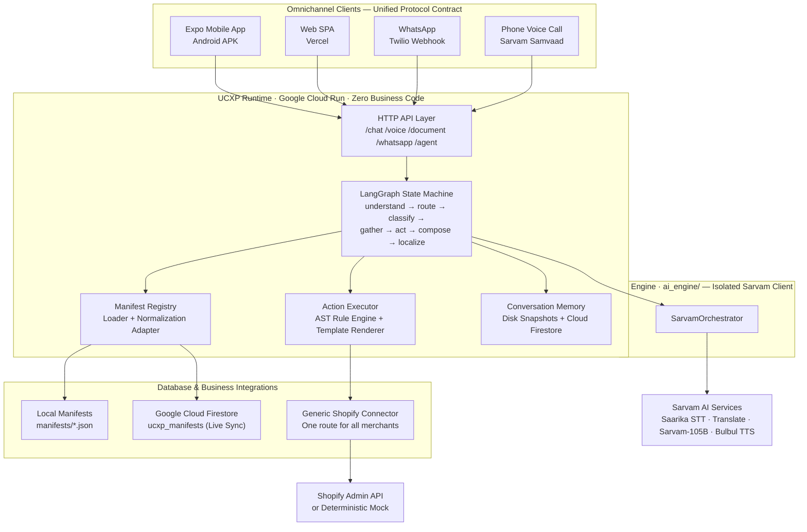
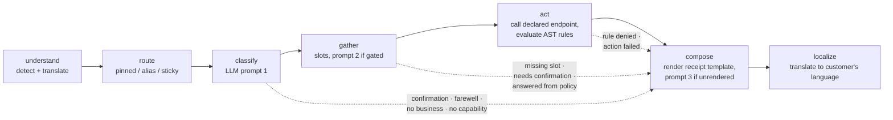

# Sahayak (सहायक) — the Universal Customer Experience Protocol (UCXP) runtime

**The UPI moment for customer support in India — one protocol for customer resolution with zero business-specific code.**

Any business publishes a **JSON manifest** declaring its capabilities, required inputs, API endpoints, business rules, and receipt templates. Sahayak's generic reasoning graph serves that business across **Web, Android, WhatsApp, and phone voice calls in any Indian language** — without editing a single line of runtime code, registering a handler, or redeploying the backend. Built on Sarvam AI + Google Cloud. Full architectural specification: <a href="PLAN.md" target="_blank" rel="noopener noreferrer"><code>PLAN.md</code></a>.

## 🌐 Live Website 

<a href="https://sahayak-ucxp.vercel.app" target="_blank" rel="noopener noreferrer">https://sahayak-ucxp.vercel.app</a>

> ⚡ **Cloud Run Backend API:** <a href="https://sahayak-49235763775.asia-south1.run.app" target="_blank" rel="noopener noreferrer">https://sahayak-49235763775.asia-south1.run.app</a> · Health: <a href="https://sahayak-49235763775.asia-south1.run.app/health" target="_blank" rel="noopener noreferrer"><code>/health</code></a> · OpenAPI Docs: <a href="https://sahayak-49235763775.asia-south1.run.app/docs" target="_blank" rel="noopener noreferrer"><code>/docs</code></a>

## 🎬 Project Demo

https://github.com/user-attachments/assets/fa20573a-8d16-46e7-bd67-376eea119c84

https://github.com/user-attachments/assets/ede17ab2-73b6-46e2-9e45-6e043a5b5059

> 🔗 **Demo Mirrors:** <a href="https://drive.google.com/file/d/1wYmC7KAdk6p2E8STL1A-TuyYvlAwnPb0/view?usp=sharing" target="_blank" rel="noopener noreferrer">Google Drive Full Demo</a>

## 📊 Presentation Deck & Architecture Slides

<a href="https://canva.link/bcgrk9wfxtp9qw6" target="_blank" rel="noopener noreferrer"><strong>👉 View the Sahayak Presentation Pitch Deck on Canva ↗</strong></a>

> 💡 *View the full presentation with problem breakdown, protocol architecture, and system diagrams: **<a href="https://canva.link/bcgrk9wfxtp9qw6" target="_blank" rel="noopener noreferrer">Canva Slide Deck</a>***

---

## 📁 Repo

| Path | What Lives Here |
|---|---|
| `ai_engine/` | The isolated Sarvam AI client. Orchestrator, Saarika STT (`saarika:v2.5`), Bulbul TTS (`bulbul:v3`), translation (`sarvam-translate:v1`), Sarvam-105B LLM, prompts as `.md`, retries, and fallback heuristics |
| `backend/app/runtime/` | The UCXP LangGraph state machine (`understand` → `route` → `classify` → `gather` → `act` → `compose` → `localize`), manifest loader, AST rule engine, receipt template renderer. Zero business-specific code |
| `backend/app/connectors/` | Generic Shopify Admin API connector serving all merchants through standard REST routes |
| `backend/app/agent_tools/` | Sarvam Samvaad voice call agent tools and the sub-second direct execution path |
| `backend/app/api/whatsapp.py` | Twilio WhatsApp adapter — transport only, converts voice notes, PDFs, and images into runtime turns |
| `backend/app/memory/` | Session and context store, memory snapshotting, and Google Cloud Firestore persistence |
| `manifests/` | Published merchant manifests declaring capabilities, endpoints, rules, and receipts |
| `frontend/` | Expo SDK 57 universal client → Web SPA (Vercel) + Android release APK |
| `dashboard/` | Merchant onboarding portal to dynamically publish and test UCXP manifests in Cloud Firestore |
| `docs/` | Deep-dive architectural documentation (`architecture.md`, `request-lifecycle.md`, `manifest-spec.md`, `channels.md`, `decisions.md`) |
| `tests/` | 112 offline unit tests verifying determinism, prompt gating, rule evaluations, and zero-business-leakage invariants |

---

## ⚡ 1. The Thesis

Everyone building AI customer support today builds a bot per company. The company's policies, endpoints, and edge cases end up hardcoded inside the assistant. That does not scale: the 100th merchant needs a 100th bot, and cross-business queries fail.

**UCXP inverts the paradigm.** A business publishes a **manifest** — a JSON document declaring:
- What it can do (**capabilities**)
- What inputs it needs (**required_inputs**)
- What endpoint it calls (**actions & endpoints**)
- What business rules guard the action (**rules**)
- What receipt the customer gets back (**receipt template**)

Any compliant runtime serves that business dynamically. The interesting engineering is not "we prompted an LLM": it is a **generic reasoning graph** whose candidate set, slots, rules, templates, and receipts are all evaluated out of a document at request time — while Shopify stores, WhatsApp chats, mobile apps, and live phone calls run through the same unified pipeline.

**A job is only done when a receipt comes back.** A bot that summarizes policy and stops has failed the customer. In Sahayak, `done` is literally `receipt is not None`.

---

## 🔍 2. Verify the Zero-Business-Code Claim

Two architectural rules guarantee this is a protocol rather than a collection of apps:

1. **Only `ai_engine/` communicates with Sarvam:** The runtime imports `SarvamOrchestrator` and calls methods on it — never an HTTP endpoint, model name, retry loop, or API key.
2. **Nothing in the runtime knows a business exists:** Business behaviour enters only through `manifests/*.json` or Firestore.

Run these two commands directly in the repository to verify:

```bash
# Rule 2 — verify zero business names appear anywhere in the runtime:
grep -rniE "flipkart|airtel|apollo|ravi|lakshmi|meena|sri-pharma|anna-groceries" \
     backend/app/runtime/
# → 0 matches

# Rule 1 — verify zero Sarvam wire access or credentials exist outside ai_engine/:
grep -rn "api\.sarvam\.ai\|SARVAM_API_KEY\|saarika\|bulbul\|sarvam-translate\|SARVAM_LLM_MODEL" \
     backend/
# → 0 matches
```

Then query the live runtime itself:

```bash
BASE=https://sahayak-49235763775.asia-south1.run.app

# The directory, comprehended dynamically from published manifests:
curl -s $BASE/businesses

# The manifest document that produced it:
curl -s $BASE/manifests/ravi-electronics
```

`GET /businesses` contains no hardcoded list; it dynamically iterates over whatever manifests are loaded into the registry.

---

## 🏗️ 3. System Architecture



The runtime and AI Engine **deploy as a single container image on Google Cloud Run and communicate in-process** — eliminating unnecessary network latency on the critical reasoning path. Every channel converges on `UcxpRuntime.run()`, meaning a photographed receipt sent over WhatsApp and a voice call produce the identical cryptographic resolution card.

---

## 🔄 4. The Single-Turn LangGraph Machine



The dotted edges represent **prompt gating**:
- A naive agent framework invokes LLMs 3–4 times every single turn.
- Sahayak calls the LLM **0 times** for confirmations, goodbyes, brand openers, or unresolvable small talk.
- It calls the LLM **1 time** for standard task resolution.
- It calls the LLM up to 3 times only when an input slot is missing *and* no template renders.

```bash
curl -s -X POST https://sahayak-49235763775.asia-south1.run.app/chat \
  -H 'Content-Type: application/json' \
  -d '{"text":"where is my order 1001","business_id":"ravi-electronics"}'
```

```json
{
  "conversation_id": "e8a42f...",
  "reply_text": "Your request is shipped, arriving Wednesday, 29 July.",
  "business_id": "ravi-electronics",
  "capability": "track_order",
  "receipt": { "label": "shipped", "tone": "success" },
  "needs": null,
  "state": "resolved",
  "language": "en-IN",
  "degraded": [],
  "latency_ms": 2100.4
}
```

---

## 📜 5. The UCXP Manifest Contract

```jsonc
{
  "ucxp_version": "0.1",
  "business": {
    "id": "deepika-andhra-pickles",
    "name": "Deepika Andhra Pickles",
    "category": "Food & Beverage",
    "languages": ["en-IN", "te-IN", "hi-IN"]
  },
  "routing": {
    "aliases": ["Deepika", "Deepika Andhra Pickles", "deepika pickles"],
    "domains": ["order", "refund"]
  },
  "capabilities": [{
    "id": "track_order",
    "description": "Find where a customer's order is and when it arrives.",
    "examples": ["where is my order", "ఆర్డర్ ఎక్కడ ఉంది"],
    "required_inputs": [{
      "name": "order_id",
      "type": "string",
      "prompt": "What's your order ID?",
      "default_from": "context.last_order_id"
    }],
    "rules": [{
      "id": "refund_window",
      "when": "result.days_since_delivery > 7",
      "deny": "Refunds are only available within 7 days of delivery."
    }],
    "confirm": false,
    "action": "get_order_status",
    "response": "Your order {{order_id}} is {{result.status}} and arrives {{result.eta}}.",
    "receipt": { "label": "Arriving {{result.eta}}", "tone": "success" }
  }],
  "endpoints": [{
    "id": "get_order_status",
    "method": "GET",
    "url": "{{connector_base}}/connectors/shopify/{{business_id}}/orders/{{order_id}}"
  }],
  "knowledge": [{
    "id": "refund_policy",
    "text": "Refunds are processed within 5-7 business days."
  }]
}
```

The candidate set for classification is generated strictly from `capabilities`. Rules are evaluated via a safe AST walker over an allowlist (never `eval`).

---

## 💻 6. Run Locally

### Prerequisites
- Python 3.11+
- Node.js ≥ 20
- Sarvam AI API Key (`SARVAM_API_KEY`)

```bash
# 1. Clone repository
git clone https://github.com/akashmeruva9/sahayak-ucxp-sarvam.git
cd sahayak-ucxp-sarvam

# 2. Setup Python environment & backend
python3 -m venv .venv
source .venv/bin/activate
pip install -r requirements.txt

cp .env.example .env
# Edit .env and supply your SARVAM_API_KEY and GCP credentials

# 3. Start UCXP Runtime Backend (http://localhost:8000)
uvicorn backend.app.main:app --reload --port 8000

# 4. Setup & Start Frontend (Web SPA)
cd frontend
npm install
npm run web
```

---

## 🧪 7. Tests

The offline test suite validates invariant rules, language identification guards, AST evaluations, prompt gating, and multi-pass alias matching without requiring external network calls:

```bash
# Run all unit tests
.venv/bin/pytest tests/

# Run runtime tests specifically
.venv/bin/pytest tests/test_runtime.py
```

---

## 🚀 8. Deployment Architecture

### Backend: Google Cloud Run
The backend runtime runs in `asia-south1` (Mumbai) on Google Cloud Run with autoscaling and zero cold-start optimization:

```bash
# One-command deployment script to Google Cloud Run:
./scripts/deploy-cloudrun.sh sahayak-ucxp asia-south1
```

- **Database:** Google Cloud Firestore in Native Mode (`ucxp_manifests` and `conversations`).
- **Auth:** Google Cloud Identity Platform (Firebase Auth) supporting Google OAuth and passwordless authentication.

### Frontend: Vercel
The frontend is deployed to Vercel as a performant web client:
- **Build settings:** Root Directory: `frontend`, Framework: `Other` (Expo Web export).
- **Environment variables:** `EXPO_PUBLIC_API_URL=https://sahayak-49235763775.asia-south1.run.app`.

---

## 🛡️ 9. Built-In Guardrails & Engineering Decisions

1. **State Machine over Unconstrained Agents:** LangGraph implements an explicit state machine with guarded conditional transitions rather than an unpredictable open-loop agent.
2. **Safe AST Rule Evaluation:** Business policy conditions (e.g. `result.days_since_delivery > 7`) are evaluated through an Abstract Syntax Tree (AST) allowlist. No `eval()` is ever permitted.
3. **Language Stickiness & Script Detection:** Prevents regional false positives on Indian proper nouns in Latin script (e.g., brand names or order IDs) while seamlessly switching when native Indic scripts (`[\u0900-\u0D7F]`) are entered.
4. **Multi-Pass Brand Alias Matching:** Resolves space typos, punctuation variances, and singular/plural variations (`"Deepik aAndhra Pickles"` $\to$ `deepika-andhra-pickles`) deterministically before any LLM is called.
5. **Gated Prompts (58 s $\to$ ~2 s):** Classify runs on a single small manifest prompt rather than the entire directory. Gather and Compose prompts are skipped entirely when templates can resolve the answer.
6. **Receipts as Resolution Invariant:** An interaction is only classified as `resolved` when a structured receipt card is generated and persisted.

---

## 📚 10. Documentation Index

Detailed specifications and architectural deep-dives live in [`docs/`](./docs/):

| Document | Description |
|---|---|
| [**architecture.md**](./docs/architecture.md) | Component maps, layering rules, deployment topology, and cross-cutting invariants |
| [**request-lifecycle.md**](./docs/request-lifecycle.md) | Turn state diagrams, prompt gating mechanics, and failure semantics |
| [**manifest-spec.md**](./docs/manifest-spec.md) | Complete schema specification, normalization mapping table, and template grammar |
| [**channels.md**](./docs/channels.md) | Omnichannel client contracts (Web, Android APK, Twilio WhatsApp, Sarvam Samvaad) |
| [**data-and-memory.md**](./docs/data-and-memory.md) | Memory layers, mid-flow confirmation survival, and Firestore session synchronization |
| [**decisions.md**](./docs/decisions.md) | Architectural decision log documenting trade-offs, constraints, and solutions |
| [**PLAN.md**](./PLAN.md) | Master development roadmap, contracts, and execution history |
